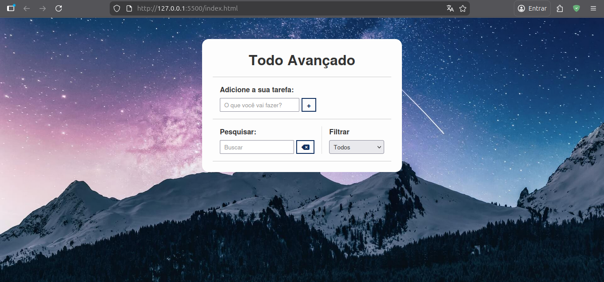
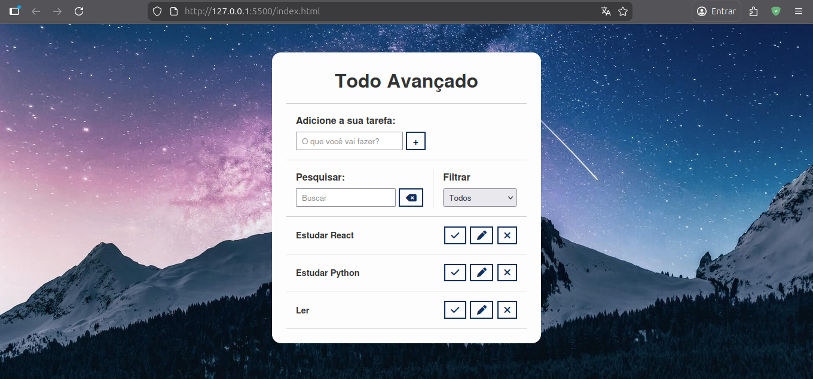
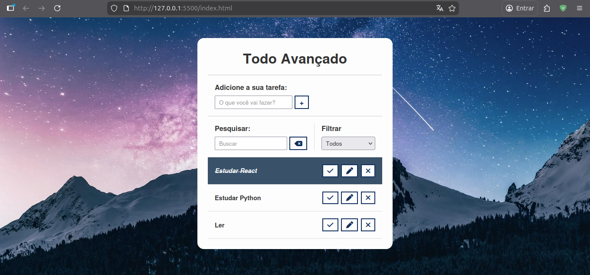
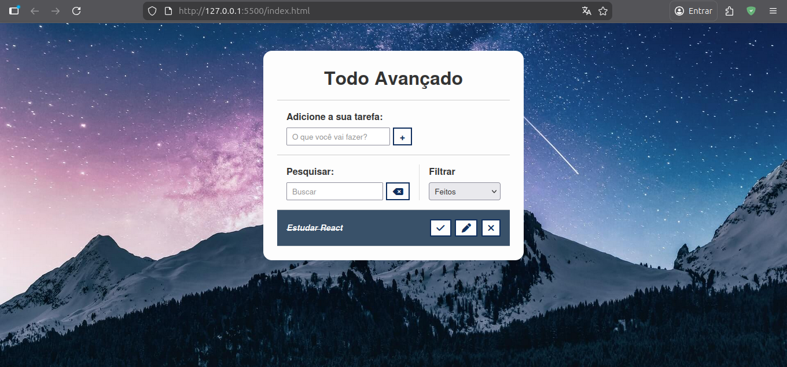

# Todo Advanced

A feature-rich Todo List application built with pure JavaScript, featuring search, filtering, and local storage persistence.

## 🚀 Technologies

This project was developed using the following technologies:

- **HTML5**: For semantic structure and accessibility.
- **CSS3**: For custom styling and responsive design.
- **JavaScript (ES6+)**: For application logic and DOM manipulation.
- **LocalStorage API**: To persist todo items even after refreshing the page.
- **Font Awesome**: Professional icons for a modern UI.

## 📂 Project Structure

```text
.
├── assets
│   ├── css
│   │   └── styles.css
│   ├── img
│   │   └── bg.jpg
│   └── js
│       └── scripts.js
├── index.html
└── README.md
```

## 💻 How to Run

You can run this project in two ways:

### 1. With Live Server (Recommended)

If you are using **VS Code**, install the **Live Server** extension.

1. Open the project folder in VS Code.
2. Right-click on `index.html`.
3. Select **"Open with Live Server"**.
4. The project will open automatically in your default browser at `http://127.0.0.1:5500`.

### 2. Without Live Server

You can simply open the file directly in any modern browser:

1. Navigate to the project folder on your computer.
2. Find the file `index.html`.
3. Right-click and select **"Open with..."** and choose your preferred browser (Chrome, Firefox, Edge, etc.).

## 📸 Previews





